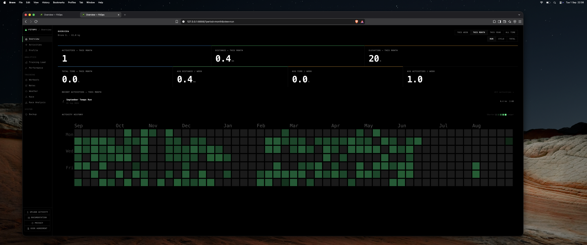
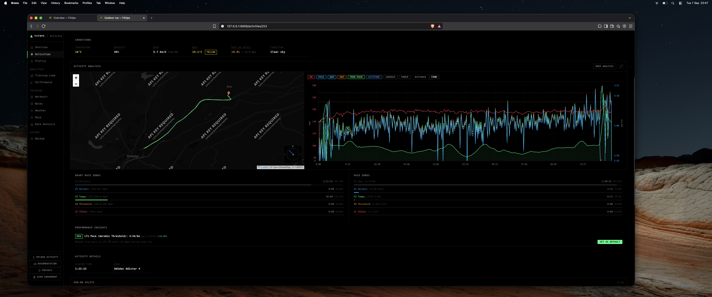
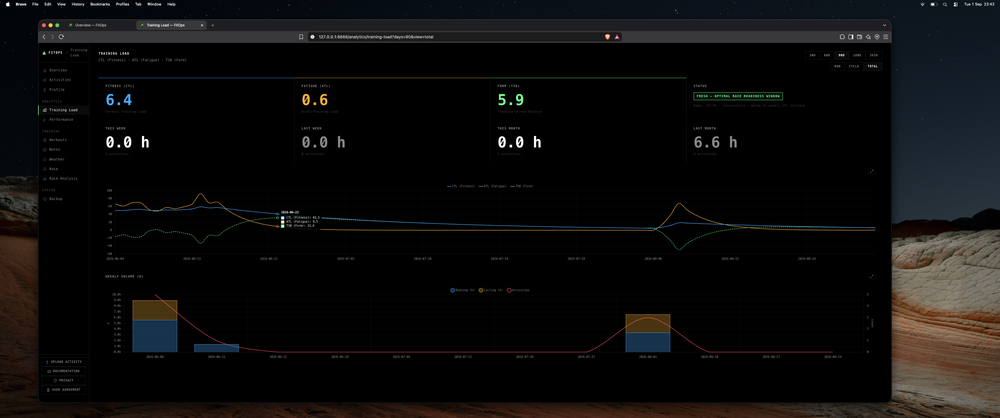
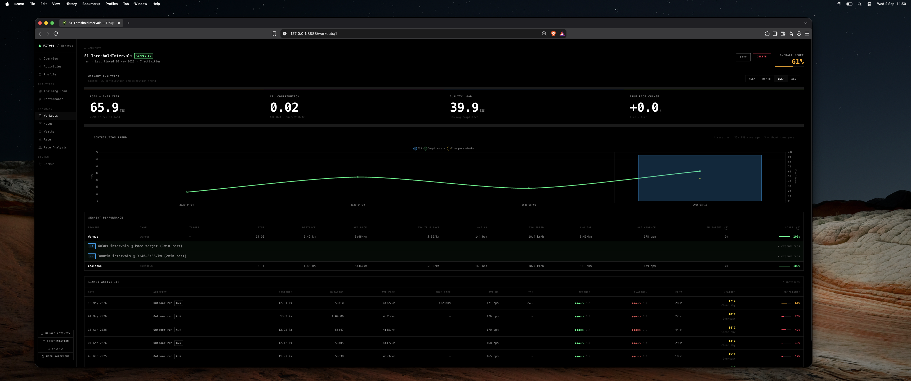
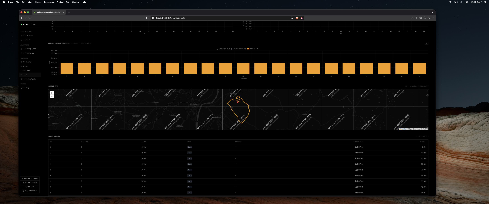

# Huawei Enterprise Application Material — FitOps draft

This is a copy-ready draft for Huawei's [Application Material (for Enterprise Developers) V3.1 PDF](/Users/bv-mac/Downloads/Application+Material+(for+Enterprise+Developers)_V3.1.pdf).

It is based on the current FitOps repository and must be reviewed before submission. The repository currently describes Huawei Health support as **planned**, not as a completed live integration. Do not claim that the technical self-test has passed or that Huawei data is already being imported.

## Public application links

| Huawei field | Value |
|---|---|
| Privacy policy | https://brunov21.github.io/FitOps-CLI/legal/privacy |
| User agreement | https://brunov21.github.io/FitOps-CLI/legal/user-agreement |
| App website | https://github.com/BrunoV21/FitOps-CLI |
| App documentation | https://brunov21.github.io/FitOps-CLI/ |
| App icon | https://brunov21.github.io/FitOps-CLI/assets/fitops-icon-216.png |

## Page 1 — Data Usage

### Permissions

Request only the read-only permissions corresponding to the following capabilities, using Huawei's exact labels in the form:

- Activity/exercise records.
- Associated activity detail and sample data needed to map duration, distance, pace/speed, heart rate, cadence, elevation, and GPS data when available.
- Privacy/authorization or granted-scope status, if Huawei exposes this as a selectable permission.

Do **not** request write permissions or advanced categories such as sleep, stress, SpO2, ECG, blood pressure, body composition, or personal information. Do not paste guessed Huawei scope identifiers; select the exact permission names shown by the console.

### Data usage scenarios and requirements

> The planned FitOps Huawei integration will request read-only Health Service Kit access only after the user explicitly connects Huawei Health and grants consent. FitOps will retrieve the user's authorized exercise/activity records and the associated activity samples needed to represent each workout. The records will be normalized into FitOps' provider-neutral activity model and stored in the user's local SQLite database at `~/.fitops/fitops.db`. The local FitOps CLI and dashboard will read that same local dataset to show activity history, maps, pace/speed, heart-rate, cadence, elevation, workout compliance, training-load, and race-analysis views. FitOps will not write records back to Huawei Health. The user can revoke Huawei authorization to stop future synchronization and can delete the local FitOps database to remove local copies.

### Data usage purpose

> To provide user-requested fitness analytics from the user's own Huawei Health activity data, including activity history, charts, workout analysis, training-load trends, and race-planning views. The data is used only to provide these FitOps features to the authorizing user. FitOps does not sell the data, use it for advertising, use it to make medical or eligibility decisions, or use it to train AI models.

### Development completion time

`[OWNER: enter the truthful expected completion date in YYYY-MM-DD format]`

Do not use the date of this draft unless the Huawei integration will actually be complete by then.

### Screenshots of app simulation

Use these as representative FitOps UI screenshots. They show the local dashboard and should be described as **FitOps interface simulations/representative screens**, not as live Huawei data. Replace them with Huawei-backed screenshots after the integration is implemented if Huawei requires proof of live functionality.

1. [Dashboard overview image](../../official/assets/dashboard-overview-hero.png)

   

2. [Activity analysis image](../../official/assets/dashboard-activity-analysis.png)

   

3. [Training-load image](../../official/assets/dashboard-training-load-detailed.png)

   

4. [Workout compliance image](../../official/assets/dashboard-workout-compliance.png)

   

5. [Race simulation image](../../official/assets/dashboard-race-simulate-results.png)

   

The CLI is also a first-class FitOps interface. Include the [CLI activity-list image](../../official/assets/cli-output-activities-list.png) only if Huawei accepts command-line screenshots as supplementary material.

## Page 3 — Company Description

The PDF requires legal/company information that is not present in this repository. Complete these fields from the registered entity's official records:

| PDF field | Entry |
|---|---|
| Has the company legally existed for more than 1 year? | `[OWNER: Yes/No — verify against incorporation date]` |
| Registered paid-up capital | `[OWNER: exact amount and currency]` |
| Brief introduction of the company | Use the project description below only if it truthfully describes the applying legal entity. |
| Company name | `[OWNER: registered legal name]` |
| Business type | `[OWNER: exact registered business type]` |
| Legal representative | `[OWNER: legal representative's full name]` |
| Business scope | `[OWNER: exact or accurately summarized registered business scope]` |
| Business license | `[OWNER: attach only if required and safe to disclose]` |

### Project/company description draft

> FitOps is an open-source, local-first fitness analytics software project for athletes. It provides a structured command-line interface for AI-agent and scripting use and a local web dashboard for human exploration. The product imports user-authorized training activity data, stores it locally, and provides activity analysis, workout compliance, training-load trends, and race-planning tools. FitOps does not sell personal data, use health data for advertising, or provide medical diagnosis or treatment.

Use the paragraph above for the company description only if the applicant is legally responsible for FitOps. Otherwise rewrite it so the registered company's actual business and services are accurately represented.

### Company business-scope image

No company registration or business-scope image is available in the repository. If the paragraph above is accepted in place of an image, no image is needed according to the PDF. Otherwise attach a truthful company overview, service infographic, organization chart, or business-scope slide supplied by the applicant. Do not use a FitOps dashboard screenshot as a company business-scope image.

## Page 5 — Project Details

### 1. Application introduction

> FitOps is a local-first fitness analytics application with two interfaces: a command-line interface for structured queries and automation, and a local web dashboard for visual analysis. The planned Huawei Health Kit integration will let a user authorize read-only access to selected Huawei exercise records and activity samples. FitOps will normalize the authorized records into its local dataset and provide activity history, maps, pace/speed, heart-rate, cadence, elevation, workout, training-load, and race-analysis views. Data remains under the user's control in the local FitOps database. The application does not write health data to Huawei, sell user data, serve health-data advertising, or provide medical diagnosis.

### 2. Application industry

Select the closest Huawei console option to:

`Sports and fitness software / fitness analytics / health and wellness technology`

Use the console's exact category label if it differs.

### 3. Project leader for Huawei-side connection (optional)

`[OWNER: full name, role, email, and phone if Huawei makes these fields available]`

### 4. Cooperation details (optional)

> FitOps is requesting read-only Health Service Kit access for a planned provider integration. No special commercial cooperation, data resale, or hardware partnership is requested. Huawei access will be used only to let an authorizing user import selected activity data into the local FitOps application.

### 5. Purchasing needs

`No — FitOps does not currently require Huawei ecosystem hardware purchases.`

Change this only if specific Huawei devices will actually be purchased or used for validation, and list the model and quantity.

## Page 6 — Technical Self-test

These values must reflect the implementation that Huawei will review. Because the repository currently marks the Huawei provider as planned, the honest draft is:

| PDF field | Draft entry |
|---|---|
| Open technical integration | `[OWNER: confirm with Huawei what this field means, then answer truthfully]` |
| Countries this app serves | `[OWNER: enter the actual target countries/regions]` |
| Commercial release or Demo | `Demo / open-source project` — use `Commercial Release` only if that is accurate. |
| Fill in the self-check result | `Pending — complete after Huawei OAuth, REST API, consent, data mapping, revocation, and deletion tests pass.` |
| Application types | `[OWNER: confirm a supported type; current FitOps is a Python CLI plus local web dashboard, not an Android, iOS, HarmonyOS, or WeChat app]` |
| Access method | `REST API` is the proposed method for a supported web/cross-platform integration; confirm with Huawei before selecting. |
| Do data permissions meet the needs? | `Not yet confirmed — answer Yes only after the end-to-end integration and scope tests pass.` |
| Do scenarios involve medical treatment? | `No` — FitOps provides fitness analytics and no diagnosis or treatment. |
| Expected authorized user scale | `[OWNER: forecast, not a guess]` |
| Interface request TPS | `[OWNER: forecast and/or Huawei-recommended value]` |
| Self-test module/result/remark | `[OWNER: complete after implementation and attach evidence]` |

### Technical test evidence to collect before submission

- Huawei authorization and consent screen using the approved Health Service Kit branding.
- Successful read of an activity record after user consent.
- Successful read of only the approved activity detail/sample data.
- Correct local persistence in `~/.fitops/fitops.db`.
- CLI and dashboard display of the imported activity.
- Revocation test showing future synchronization stops.
- Local deletion test showing imported local copies are removed.
- Error handling for missing consent, expired authorization, unavailable data, and Huawei API errors.

## Assets to copy into the PDF

| Purpose | Repository file |
|---|---|
| FitOps application icon | [fitops-icon-216.png](../../official/assets/fitops-icon-216.png) |
| Dashboard overview | [dashboard-overview-hero.png](../../official/assets/dashboard-overview-hero.png) |
| Activity analysis | [dashboard-activity-analysis.png](../../official/assets/dashboard-activity-analysis.png) |
| Training load | [dashboard-training-load-detailed.png](../../official/assets/dashboard-training-load-detailed.png) |
| Workout compliance | [dashboard-workout-compliance.png](../../official/assets/dashboard-workout-compliance.png) |
| Race simulation | [dashboard-race-simulate-results.png](../../official/assets/dashboard-race-simulate-results.png) |
| Optional CLI evidence | [cli-output-activities-list.png](../../official/assets/cli-output-activities-list.png) |

For Huawei authorization UI, use Huawei's official Health Service Kit logo where the form asks for Huawei service branding. The FitOps icon above is the application icon, not a replacement for Huawei's service logo.

## Final owner checklist

- [ ] Confirm the applying legal entity and whether this enterprise PDF is the correct Huawei path.
- [ ] Fill company age, paid-up capital, legal name, business type, legal representative, business scope, and license.
- [ ] Fill the project leader and contact details if requested.
- [ ] Confirm countries served, application type, expected users, and TPS.
- [ ] Implement and run the Huawei technical self-test before claiming completion.
- [ ] Replace representative screenshots with Huawei-backed screenshots if Huawei requires live evidence.
- [ ] Verify every requested permission is read-only and necessary.
- [ ] Review Huawei's agreements and submit only after all statements are truthful for the applying entity and current implementation.
