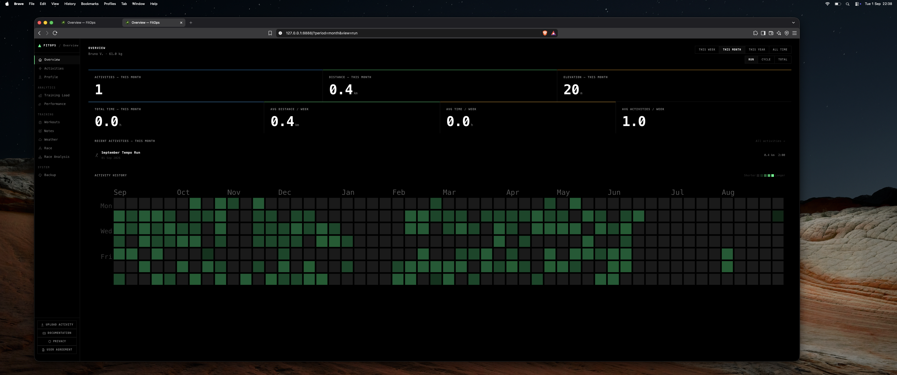
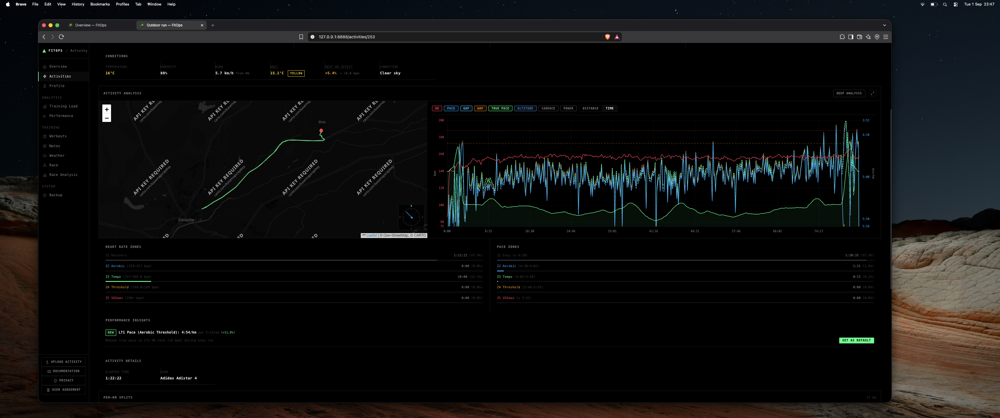
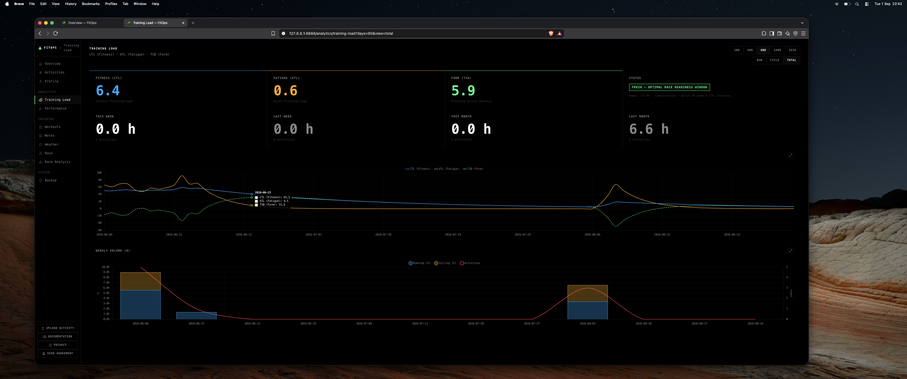
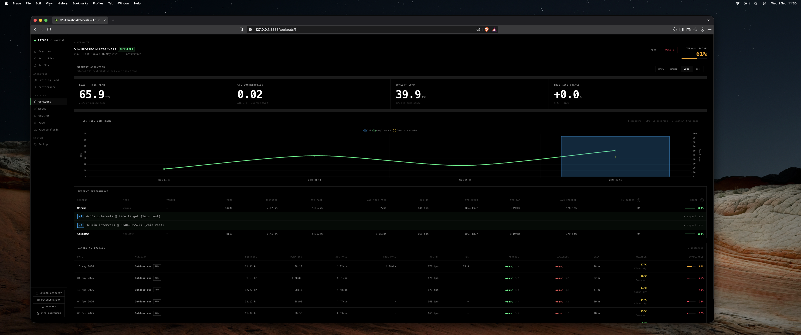
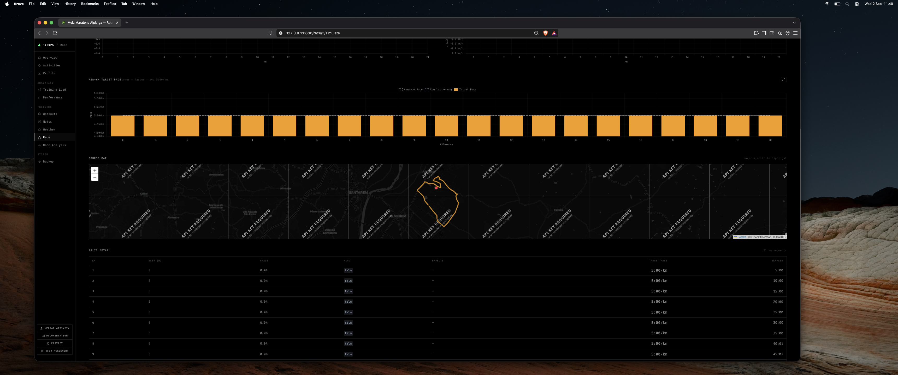

# Huawei Health Service Kit — Data Usage sheet draft

This draft matches the **Data Usage (Mandatory)** sheet shown in Huawei's application-material workbook. Delete the blue example rows and enter the FitOps row below. Use Huawei's exact scope label from the console if it differs from the wording here.

FitOps currently has no live Huawei integration, so the completion date and final self-test status must be supplied only after the integration is implemented and tested.

## Sheet-level values

| Sheet column | FitOps entry |
|---|---|
| Support for iOS | `No — FitOps has no iOS client.` |
| Client Type | `Website / REST API` — FitOps is a local-first CLI and web dashboard; confirm the exact Huawei option before submitting. |
| Development Completion Time | `[OWNER: enter the truthful committed date as YYYY-MM-DD]` |

## Row 1 — activity records

Copy this row into the first available data row:

| No. | Scope | Requirement | Scenario | Support for iOS | Client Type | Development Completion Time |
|---:|---|---|---|---|---|---|
| 1 | Read exercise/activity records | Read the user's Huawei Health exercise records after explicit authorization. Use the activity-record permission for historical walking, running, cycling, and other supported workouts. Read the summary and only the associated activity details needed by FitOps, such as duration, distance, pace/speed, calories, heart-rate statistics, cadence/steps, elevation, and GPS route data when Huawei provides them. No write access is requested. | After a user connects Huawei Health and grants consent, FitOps will retrieve the user's authorized exercise records through the Health Service Kit REST API. FitOps will normalize the records into its provider-neutral activity model and store them in the user's local SQLite database at `~/.fitops/fitops.db`. The local CLI and dashboard will display activity history and fitness analytics from that same local dataset. FitOps will not sell the data, use it for advertising, send it to third parties, train AI models on it, or write records back to Huawei Health. Revoking authorization stops future synchronization; deleting the local database removes local copies. | No | Website / REST API | `[OWNER: YYYY-MM-DD]` |

### Scope label to select in Huawei Console

Select the exact read permission under **Activity records → Activity**. Huawei's current documentation identifies the REST/OAuth read scope as:

```text
https://www.huawei.com/healthkit/activity.read
```

The Android SDK documentation may display the equivalent constant as `Scopes.HEALTHKIT_ACTIVITY_READ`; do not paste that SDK constant into the workbook unless Huawei's console specifically requests it.

Huawei states that the statistical data associated with an exercise record is included with the exercise-record permission, so do not create separate rows for distance, speed, calories, heart-rate statistics, or cadence unless the console explicitly requires separate permissions.

## Do not add these rows for the first FitOps application

Do not request any scope that the current FitOps feature set does not implement:

- Sleep
- Stress
- SpO2
- ECG
- Blood pressure
- Body composition or body fat
- Personal information such as age or gender
- Real-time exercise recording
- Write activity or health records
- Data subscriptions/webhooks

If Huawei requires a separate row for GPS/location detail, use the same truthful local-storage and analytics scenario above, change the scope to the exact console label shown for **Activity records → Location**, and request it only if the implemented integration actually reads route coordinates.

## Supporting screenshots and images

The Data Usage sheet itself has no screenshot column in the visible table. Use these images in Huawei's separate **App Info**, application-material PDF, or review-upload area. Label them as representative FitOps interface screenshots until Huawei-backed data is available.

### App icon

[FitOps icon — 216 × 216 PNG](../../official/assets/fitops-icon-216.png)


### App simulation screenshots

1. [Dashboard overview](../../official/assets/dashboard-overview-hero.png)

   

2. [Activity analysis](../../official/assets/dashboard-activity-analysis.png)

   

3. [Training load](../../official/assets/dashboard-training-load-detailed.png)

   

4. [Workout compliance](../../official/assets/dashboard-workout-compliance.png)

   

5. [Race simulation](../../official/assets/dashboard-race-simulate-results.png)

   

Use Huawei's official **HUAWEI Health** logo for Huawei authorization UI. The FitOps icon is only the application icon and must not replace Huawei service branding.

## Pre-submission checks

- [ ] Replace the completion-date placeholder with a real date.
- [ ] Confirm that Huawei's selected scope exactly matches the implemented API call.
- [ ] Confirm whether Huawei wants `Website`, `Web application`, or another client-type label.
- [ ] Keep `Support for iOS` as `No` unless an iOS client is actually built.
- [ ] Do not claim that the technical self-test passed before the Huawei integration exists.
- [ ] Replace representative screenshots with Huawei-backed screenshots if Huawei requires live evidence.
- [ ] Verify the data-usage text against the final privacy policy and user consent screen.

## Huawei references

- [Health Kit overview](https://developer.huawei.com/consumer/en/hms/huaweihealth/)
- [Applying for Health Service Kit](https://developer.huawei.com/consumer/en/doc/development/HMSCore-Guides/apply-kitservice-0000001050071707)
- [Running Form — activity read scope](https://developer.huawei.com/consumer/en/doc/hmscore-guides/running-posture-0000001148000958)
- [Walking exercise-record data](https://developer.huawei.com/consumer/en/doc/HMSCore-Guides/walking-0000001132087086)
